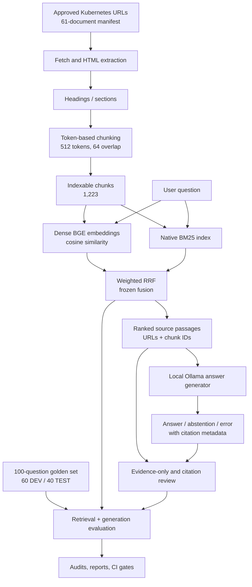

# GroundTruth

### Evaluation-first Retrieval-Augmented Generation for Kubernetes documentation

[](https://www.python.org/)
[](https://kubernetes.io/docs/)
[](#retrieval-architecture)
[](#project-status)

**GroundTruth is a reproducible, evaluation-first RAG research prototype.** It retrieves evidence from a versioned corpus of official Kubernetes documentation, generates locally hosted answers with inline source citations, and measures retrieval quality separately from answer factuality and citation support.

The project's central principle is simple: **a plausible answer with a citation is not automatically a correct or grounded answer.** GroundTruth makes the retrieval and generation stages independently observable, preserves a frozen benchmark, and treats evidence verification, abstention, and errors as different outcomes.

> **Project status:** Research/portfolio preview (evaluation stage). The hybrid retrieval baseline is frozen and regression-tested. Local answer generation works, but factuality, citation entailment and abstention are *not* independently validated for production use. See [Results](#results), [Limitations](#limitations-and-validity), and [Release criteria](#release-criteria).

## Contents

- [What GroundTruth does](#what-groundtruth-does)
- [Architecture](#architecture)
- [Project status](#project-status)
- [Requirements and dependencies](#requirements-and-dependencies)
- [Installation](#installation)
- [Quick start](#quick-start)
- [Rebuild the corpus and indexes](#rebuild-the-corpus-and-indexes)
- [Retrieval architecture](#retrieval-architecture)
- [Evaluation and reproducibility](#evaluation-and-reproducibility)
- [Results](#results)
- [Repository structure](#repository-structure)
- [Testing and CI](#testing-and-ci)
- [Troubleshooting](#troubleshooting)
- [Limitations and validity](#limitations-and-validity)
- [Release criteria](#release-criteria)
- [Roadmap](#roadmap)
- [Documentation, attribution and licensing](#documentation-attribution-and-licensing)

## What GroundTruth does

GroundTruth provides an end-to-end experimental pipeline:

1. **Curates documentation:** works from an explicitly reviewed, 61-page Kubernetes documentation URL manifest across seven topic groups.
2. **Builds a traceable corpus:** downloads and extracts documents, preserves heading/URL metadata, creates deterministic section-bounded text chunks, and filters non-indexable fragments.
3. **Indexes complementary retrieval signals:** BGE-small dense embeddings alongside a native BM25 index.
4. **Retrieves evidence:** combines ranked dense and sparse candidates using weighted Reciprocal Rank Fusion (RRF).
5. **Generates cited responses:** sends retrieved passages to a local Ollama model, requesting source markers such as `[C1]` and permitting abstention when the source is insufficient.
6. **Evaluates components separately:** tests retrieval relevance, response validity, factual completeness, citation support, negative questions, and failure handling.
7. **Prevents silent benchmark drift:** checks a fingerprinted golden set and a frozen retrieval configuration with local regression tests and GitHub Actions.

**Intended audience:** machine learning / LLM engineering practitioners interested in measurable retrieval quality, practical RAG failure analysis, evidence provenance, and reproducible experiments.

**Not included:** a production Kubernetes assistant, autonomous infrastructure changes, or a general-purpose web UI. GroundTruth answers documentation questions; it does **not** administer a Kubernetes cluster.

## Architecture



The **retriever is deliberately frozen** while answer-generation experiments are evaluated. Shadow verifier/repair experiments are kept separate and are not automatically applied to live answers.

## Project status

| Component | Status |
| --- | --- |
| Approved Kubernetes documentation corpus | Implemented |
| Deterministic sections, chunking and indexes | Implemented |
| Dense, BM25, weighted hybrid retrieval | Implemented |
| Frozen golden set and retrieval regression gate | Implemented |
| Local Ollama generation with citation syntax validation | Implemented; quality limitations remain |
| Saved DEV evidence and first-pass factuality review | Implemented; assistant-reviewed, not independent ground truth |
| Evidence-gate / repair / source-first experiments | **Shadow only**, not deploy-ready |
| Independent factuality adjudication | Outstanding |
| Final held-out generation evaluation | Outstanding |
| Production deployment | Out of scope for this release |

## Requirements and dependencies

### System requirements

- **Python 3.10** is the project's demonstrated environment. Python 3.10+ is the intended target; other versions have not all been regression-tested.
- **Git** to clone and version the repository.
- **Internet access for initial setup** to fetch Kubernetes documents and download embedding and Ollama models. Saved-report audits can run offline.
- **CPU is sufficient** for indexing/retrieval and all evidence-only audits, though dense index creation and inference can be slower. An NVIDIA GPU is optional for PyTorch; Ollama manages its own execution device.
- **Ollama** is required only to *generate* answers locally. Retrieval, most evaluations, and fast CI do not require an Ollama server.
- A local terminal (instructions below use Windows PowerShell; Python module commands also work on Linux/macOS after activating a virtual environment).

### Python packages

The repository's verified import paths use these direct packages. Install them using the supplied [`requirements.txt`](requirements.txt):

| Package | Purpose | Needed for |
| --- | --- | --- |
| `numpy` | Embedding arrays and index artifacts | Dense indexing/retrieval |
| `torch` (PyTorch) | Model execution and device selection | Dense embeddings and optional reranking |
| `sentence-transformers` | BGE embedding model and cross-encoder experiments | Dense indexing/retrieval |
| `tiktoken` | `cl100k_base` token accounting and chunk boundaries | Corpus chunking |
| `PyYAML` | Corpus manifest parsing | Ingestion/chunking |
| `beautifulsoup4` | HTML parsing | Document extraction |

**Additional details:**

- `huggingface-hub` and `tokenizers` are installed transitively with the model stack; direct imports also appear in an *optional embedding-truncation diagnostic*. The supplementary [`requirements-optional.txt`](requirements-optional.txt) lists them explicitly for that diagnostic, plus `requests` as a compatibility extra for alternative HTTP ingestion implementations.
- Core retrieval's BM25 implementation and most evaluation/CI utilities use the Python standard library; they do **not** need `rank-bm25`, FAISS, ChromaDB, LangChain, LlamaIndex, Ragas, Streamlit, or a vector database.
- The local Ollama backend uses HTTP via Python's standard library. **No Python `ollama` SDK is required.**
- The optional external OpenAI-compatible backend uses an API key and may incur charges; it is **not necessary** to reproduce the baseline.
- No single cross-platform, fully resolved dependency lockfile was available in the reviewed project artifacts. These requirement files are **direct-dependency manifests**, not a claim that every latest transitive package combination has been tested. For exact reproducibility, record your successful local environment with `python -m pip freeze > requirements-lock-local.txt` (consider keeping machine-specific locks out of public CI).

### PyTorch installation: choose CPU or CUDA

PyTorch wheels depend on your operating system and accelerator. Choose the matching command from the [official PyTorch installation selector](https://pytorch.org/get-started/locally/), **then** install the remaining Python dependencies.

A CPU-only setup can start with:

```powershell
python -m pip install torch --index-url https://download.pytorch.org/whl/cpu
```

If you have a supported NVIDIA GPU, use PyTorch's selector for the appropriate CUDA build instead of assuming a CUDA wheel works on every machine. Verify your installation:

```powershell
python -c "import torch; print('PyTorch:', torch.__version__); print('CUDA available:', torch.cuda.is_available())"
```

CUDA is *not* required to run the documented CPU commands.

## Installation

The commands below assume the complete GroundTruth repository is present. **This README and the requirements files are documentation/dependency files, not a substitute for the source modules, manifest, frozen golden set, and reports.**

### 1. Clone the repository

```powershell
# Replace with the actual URL of this GitHub repository.
git clone https://github.com/blurredLogic/GroundTruth.git
cd GroundTruth
```

If you already have the repository locally, open PowerShell at its root instead:

```powershell
cd C:\path\to\GroundTruth
```

### 2. Create and activate a virtual environment

**Windows PowerShell:**

```powershell
py -3.10 -m venv .venv
.\.venv\Scripts\Activate.ps1
python -m pip install --upgrade pip
```

If PowerShell blocks activation, use `.venv\Scripts\python.exe` directly, or activate in Command Prompt with `.venv\Scripts\activate.bat`. Do not disable machine-wide execution protections just to install this project.

**Linux/macOS:**

```bash
python3.10 -m venv .venv
source .venv/bin/activate
python -m pip install --upgrade pip
```

### 3. Install packages

Choose the correct PyTorch installation first (see above), then run:

```powershell
python -m pip install -r requirements.txt
python -m pip check
```

To run optional embedding-truncation investigations:

```powershell
python -m pip install -r requirements-optional.txt
```

The project runs its package entry points as `python -m groundtruth...` **from the repository root**; an editable `pip install -e .` step is not required by the reviewed source layout.

### 4. Install the local LLM (for answer generation only)

1. Install Ollama from [ollama.com/download](https://ollama.com/download).
2. Start the Ollama desktop application or server.
3. Download the project's tested local development model:

```powershell
ollama pull llama3.2:3b
ollama list
```

The generation code connects by default to `http://127.0.0.1:11434`. If Ollama is not running as a service, start it in a *separate* terminal using `ollama serve`. **There is no required paid API or `OPENAI_API_KEY` for local generation.**

### 5. Confirm the required project artifacts

Before running the full frozen regression, check that these exist:

```text
manifest/kubernetes_v0.1.yaml
data/processed/sections.jsonl
data/evaluation/golden_questions.jsonl
configs/frozen_retrieval_v1.json
```

For retrieval or generation, you also need built local indexes under `data/index/dense/` and `data/index/bm25/`, or must build them as described below. A GitHub clone may intentionally omit raw HTML, downloaded model weights, generated indexes and large reports.

## Quick start

These examples presume that the canonical **dense and BM25 indexes have already been built**.

### Retrieve passages without a language model

```powershell
python -m groundtruth.retrieval.hybrid_retriever "What is a PersistentVolume in Kubernetes?" --device cpu --top-k 5 --candidate-k 20 --rrf-k 20 --dense-weight 1.0 --bm25-weight 0.1
```

Expect ranked chunks containing source URLs, stable chunk IDs and retrieval scores. This is the easiest way to inspect retrieval before involving a language model.

### Ask a cited question with Ollama

```powershell
python -m groundtruth.generation.grounded_qa "What is a PersistentVolume in Kubernetes?" --backend ollama --model llama3.2:3b --device cpu --top-k 4
```

- `--device cpu` selects the device for **dense retrieval**; Ollama runs its own inference server and chooses its own hardware.
- `--top-k 4` supplies four fused evidence passages to the answer generator in the tested DEV configuration.
- Accepted formatted answers use inline markers such as `[C1]`. The response may also abstain; an invalid response is treated as a generation error, not silently accepted.
- Citation syntax and passage provenance **do not prove** that the answer's claims are supported.

For machine-readable output:

```powershell
python -m groundtruth.generation.grounded_qa "What is a PersistentVolume in Kubernetes?" --backend ollama --model llama3.2:3b --device cpu --top-k 4 --json
```

## Rebuild the corpus and indexes

**Use this workflow to create a fresh local corpus.** Downloading the *current* live Kubernetes docs may change the text compared with the frozen benchmark; therefore a fresh rebuild from live web pages is **not automatically equivalent** to the previously frozen experiment. Record timestamps, source hashes, and manifests. For faithful CI regression use the committed `sections.jsonl` and the frozen config instead.

Run each command from the repository root, in order:

### 1. Fetch approved Kubernetes documents

```powershell
python -m groundtruth.ingestion.fetch_documents manifest/kubernetes_v0.1.yaml
```

This step validates the manifest and downloads the approved pages. It requires a network connection; raw documents and fetch metadata are written under `data/raw/`. The downloader implementation may require an additional HTTP client (for example, `requests`). If its imports require one, install [`requirements-optional.txt`](requirements-optional.txt) and record the resolved dependency version in your local lockfile.

### 2. Extract and normalize document content

```powershell
python -m groundtruth.ingestion.extract_documents manifest/kubernetes_v0.1.yaml
```

This extracts the main documentation content into structured local files with metadata, removing navigation and page boilerplate.

### 3. Build sections from headings

```powershell
python -m groundtruth.ingestion.build_sections manifest/kubernetes_v0.1.yaml
```

### 4. Create deterministic token-bounded chunks

```powershell
python -m groundtruth.ingestion.build_chunks manifest/kubernetes_v0.1.yaml --target-tokens 512 --overlap-tokens 64
```

### 5. Filter and prepare indexable chunks

```powershell
python -m groundtruth.indexing.prepare_corpus
```

The frozen baseline contains **1,223 indexable chunks**. Differences in fetched source content or extraction version can change this count; do not silently relabel a changed corpus as the frozen baseline.

### 6. Build the dense vector index

```powershell
python -m groundtruth.indexing.build_dense_index --model BAAI/bge-small-en-v1.5 --device cpu
```

The first run downloads model weights from Hugging Face. The model produces 384-dimensional embeddings, which are compared using cosine similarity. GPU acceleration is optional.

### 7. Build native BM25 index

```powershell
python -m groundtruth.indexing.build_bm25_index --k1 1.5 --b 0.75
```

Finally, try the [hybrid retrieval command](#retrieve-passages-without-a-language-model).

## Retrieval architecture

### Dense retriever

- Encoder: [`BAAI/bge-small-en-v1.5`](https://huggingface.co/BAAI/bge-small-en-v1.5)
- Embedding dimension: **384**
- Similarity: **cosine**
- Query prefix: **disabled** in the frozen baseline

### Sparse retriever

- Custom native **BM25** implementation
- `k1 = 1.5`, `b = 0.75`
- Shared **1,223-chunk** canonical indexable corpus

### Hybrid rank fusion

GroundTruth uses weighted Reciprocal Rank Fusion instead of simply adding incomparable dense and BM25 scores:

$$
\operatorname{RRF}(d)=\sum_{r\in\{\text{dense},\text{BM25}\}}\frac{w_r}{k+\operatorname{rank}_r(d)}
$$

Frozen settings:

| Setting | Value |
| --- | ---: |
| Dense weight | `1.0` |
| BM25 weight | `0.1` |
| RRF constant `k` | `20` |
| Candidate depth per retriever | `20` |
| Default generation evidence count in DEV experiment | `4` |
| Chunk target / overlap | `512 / 64` tokens |

These were selected on development experiments and are preserved in the frozen retrieval configuration. **Do not retune on held-out TEST questions.**

## Evaluation and reproducibility

### Benchmark design

The frozen, curated evaluation set is stored at:

```text
data/evaluation/golden_questions.jsonl
```

| Split | Questions | Answerable | Negative / near-miss |
| --- | ---: | ---: | ---: |
| DEV | 60 | 54 | 6 |
| TEST | 40 | 36 | 4 |
| **Total** | **100** | **90** | **10** |

It includes categories such as direct factual, comparison, scenario/application, multi-hop, troubleshooting and negative near-miss questions. **The original gold labels were assistant-curated and need additional independent adjudication** before they should be called expert-verified benchmark ground truth.

### Retrieval evaluation

The available evaluators report:

- **Recall@k:** whether retrieved results contain the judged relevant passages.
- **MRR:** reciprocal rank of the first relevant hit (aggregated over questions).
- **nDCG@k:** rank-sensitive gain from graded relevance labels.
- **Top-1 hit rate:** fraction with a relevant passage ranked first.

Run a **DEV** evaluation for inspection without altering the benchmark:

```powershell
python -m groundtruth.evaluation.evaluate_hybrid --split dev --device cpu --candidate-k 20 --rrf-k 20 --dense-weight 1.0 --bm25-weight 0.1 --top-k 10 --report-output reports/evaluation/hybrid_dev_current.json
```

The held-out retrieval **regression** is governed by the existing baseline configuration and runner, not by arbitrary ad-hoc results.

### Generation evaluation (DEV only)

First run a small smoke test:

```powershell
python -m groundtruth.evaluation.evaluate_generation --backend ollama --model llama3.2:3b --device cpu --split dev --top-k 4 --limit 5 --report-output reports/generation/smoke_dev.json --review-output reports/generation/smoke_dev_review.csv
```

Then run all DEV questions, omitting `--limit`:

```powershell
python -m groundtruth.evaluation.evaluate_generation --backend ollama --model llama3.2:3b --device cpu --split dev --top-k 4
```

For an interrupted run, use the **same settings** and append `--resume`:

```powershell
python -m groundtruth.evaluation.evaluate_generation --backend ollama --model llama3.2:3b --device cpu --split dev --top-k 4 --resume
```

The evaluator writes a question-by-question checkpoint, a JSON report and a CSV review sheet under `reports/generation/`. Unresolved invalid JSON/citation responses are recorded as **generation errors**, not successful abstentions.

### Evidence-only and factuality audits (no Ollama)

Once the saved DEV generation report and the corresponding review artifacts are present:

```powershell
# Extract source quotations and create review packets.
python -m groundtruth.evaluation.evidence_only --input reports/generation/grounded_qa_dev.json --output-prefix reports/evidence_only/dev_review

# Reproduce the assistant first-pass factuality audit.
python -m groundtruth.evaluation.answer_factuality_audit

# Review frozen-report provenance and DEV release artifacts.
python -m groundtruth.evaluation.dev_release_audit

# Run the evidence diagnostic and research-release preflight.
python -m groundtruth.evaluation.multihop_closure_audit
python -m groundtruth.evaluation.release_readiness_audit
```

**Do not treat the factuality audit as independent scoring.** The existing v0.7 dataset contains an assistant first-pass assessment; independent-review fields remain explicitly unfilled until a separate reviewer judges each answer and cited passage. Some commands validate exact input hashes; use the original saved report, not a newly generated report with the same filename.

### Shadow-only research experiments

The repository additionally contains evidence-gate verification, answer-repair and source-first regeneration experiments (`evidence_gate.py`, `evidence_repair.py`, `source_first_replay.py`). They are **offline/shadow analyses**, not deployed safeguards. Tests have shown incorrect self-verifier acceptances and timeouts. Their reports must not be combined with the frozen official retrieval result or presented as proof of correct generation.

## Results

### Frozen held-out retrieval baseline — Hybrid RRF v0.2

Results on **40 TEST questions**, where the retrieval-quality metrics were computed on the **36 answerable** cases. The four negative questions are evaluated separately.

| Metric | Frozen TEST value |
| --- | ---: |
| Recall@5 | **0.664352** |
| Recall@10 | **0.773148** |
| MRR | **0.846561** |
| nDCG@5 | **0.755878** |
| nDCG@10 | **0.785889** |
| Top-1 hit rate | **0.777778** |

The values are historical, frozen local benchmark results, not guarantees on live documentation or external questions. Read [`configs/frozen_retrieval_v1.json`](configs/frozen_retrieval_v1.json) for exact regression tolerances and [`README_CI.md`](README_CI.md) for the original quality-gate rationale if these files are present in the published repository.

### Initial local generation DEV findings

A prior, unchanged **60-question DEV** run using local `llama3.2:3b` recorded:

| Outcome | Count |
| --- | ---: |
| Generated answers | 56 |
| Abstentions | 1 |
| Generation errors | 3 |
| Negative questions answered instead of abstained | 5 of 6 |

An **assistant first-pass** review of those 56 answers recorded **26 correct-and-complete, 17 correct-but-incomplete and 13 incorrect** answers. The same preliminary review judged citation support **24 fully supported, 23 partial/misattributed and 9 unsupported**. These are transparent diagnostic counts, **not independently adjudicated accuracy metrics**. The small local verifier also incorrectly approved an unsupported answer during research experiments.

### Evidence coverage and multi-part diagnostic

Source-sufficiency review of all 60 DEV questions (including separately recovered passages for three generation-error records) yielded **35 supported, 17 partial, 5 insufficient and 3 contradicted** judgments. This concerns *evidence availability*, **not answer accuracy**. Separately, manually decomposed DEV retrieval queries recovered the missing workload-selector and CSI snapshot/cloning information for `k8s-034` and `k8s-068`. That targeted experiment is **not** a replacement for original single-query recall metrics.

## Repository structure

Representative layout of the assembled project (some data/index outputs are created locally and are not necessarily committed to Git):

```text
GroundTruth/
├── .github/workflows/            # Fast CI and optional full regression
├── configs/
│   └── frozen_retrieval_v1.json  # Benchmark fingerprints and quality gates
├── manifest/
│   └── kubernetes_v0.1.yaml      # Approved source URLs
├── groundtruth/
│   ├── ingestion/                # Fetch, extract, section and chunk pipeline
│   ├── indexing/                 # Corpus preparation, dense and BM25 indexes
│   ├── retrieval/                # Dense, BM25, RRF, optional reranker
│   ├── generation/               # Cited answer generator / local Ollama
│   ├── evaluation/               # Retrieval and factuality / evidence audits
│   └── ci/                       # Frozen-set and regression checks
├── data/
│   ├── raw/                      # Downloaded documentation (generated)
│   ├── processed/                # Sections, chunks (may be tracked for CI)
│   ├── index/                    # Generated search indexes
│   └── evaluation/
│       └── golden_questions.jsonl
├── reports/                      # Generated evaluation results and reviews
├── tests/
├── requirements.txt
├── requirements-optional.txt
└── README.md
```

**Publication rule:** to make the manual full-regression GitHub Action work from a clean checkout, the repository must contain (or restore through an explicitly configured action) `data/processed/sections.jsonl`, `manifest/kubernetes_v0.1.yaml`, `data/evaluation/golden_questions.jsonl`, and the CI baseline config. Do not commit large embeddings or model cache directories unless you have a deliberate artifact strategy.

## Testing and CI

### Fast checks — no model inference

```powershell
python -m compileall -q groundtruth
python -m groundtruth.ci.check_golden
python -m unittest discover -s tests -p "test_ci_gates.py" -v
python -m unittest discover -s tests -p "test_bm25_smoke.py" -v
```

To run the complete local suite when all optional experiment modules are installed:

```powershell
python -m unittest discover -s tests -p "test_*.py" -v
```

Some tests target optional experiments or require their fixtures. Run the targeted tests that accompany an installed module if the full optional suite is unavailable.

### Frozen retrieval regression — fresh rebuild

```powershell
python -m groundtruth.ci.run_frozen_regression --preflight-only
python -m groundtruth.ci.run_frozen_regression --device cpu
```

This creates indexes under a separate `data/ci/frozen_retrieval/` workspace, checks corpus determinism, evaluates a fresh held-out retrieval run, and compares the results against the locked quality thresholds. It does **not** overwrite the canonical indexes or historical evaluation report. This full regression uses the **existing** TEST split for a locked engineering gate, not for tuning or selecting new parameters.

### GitHub Actions

- **GroundTruth fast CI:** runs on push/pull request; compilation, golden-set integrity and dependency-light tests. It does **not** prove that fresh neural retrieval passed.
- **GroundTruth frozen retrieval regression:** manually triggered via the GitHub **Actions** tab; creates fresh CPU indexes and enforces frozen metric floors. It downloads dependencies and requires the tracked/restoreable corpus inputs listed above.

No paid inference is needed for these GitHub workflows. The slow, model-backed workflow is intentionally **manual**, not run on every commit.

## Troubleshooting

| Symptom | Likely cause | Recommended action |
| --- | --- | --- |
| `ModuleNotFoundError: groundtruth` | Command launched outside repository root or missing source tree | `cd` to project root, activate `.venv`, run `python -m ...` |
| `No module named yaml` | PyYAML not installed into active interpreter | `python -m pip install -r requirements.txt`; verify interpreter |
| Missing `bs4` / `tiktoken` | Ingestion dependencies missing | Reinstall requirements in active virtual environment |
| `torch.cuda.is_available()` is `False` | CPU-only wheel, incompatible GPU/driver, or CUDA mismatch | Continue with `--device cpu`, or choose an appropriate wheel from the PyTorch installer |
| Hugging Face warns about `HF_TOKEN` | Unauthenticated model download rate-limit warning | Public model works without a token; set a token only if required for downloads |
| Ollama connection refused at port `11434` | Local server not running | Start Ollama / `ollama serve`, confirm `ollama list` |
| Ollama times out / runs out of memory | Local model/resource constraints | Run smaller query subsets; leave retrieval on CPU; avoid loading multiple GPU models together |
| Missing `data/index/dense/` or `data/index/bm25/` | Index artifacts not checked in or never built | Complete the index build steps |
| Invalid JSON or citation mismatch | Local model output failed strict validation | Review debug files under `reports/generation/debug_failures/`; do not bypass validation |
| Frozen regression fails after rebuilding live docs | Corpus changed or frozen inputs are missing | Use committed frozen sections and manifest; investigate source/hash drift rather than updating thresholds |
| Evidence report fingerprint mismatch | Generated or edited report differs from reviewed original | Preserve historical input and run the audit against its matching review artifacts |
| A GitHub CI badge is green but generation is wrong | Fast CI tests integrity, not semantic correctness | Inspect factuality, citation and negative-case review separately |

## Limitations and validity

- **Scope:** 61 Kubernetes pages, not the entire current Kubernetes documentation or a continuously synchronized web index.
- **Evolving source:** documentation URLs can change; freezing extracted sections and tracking their hashes is essential to reproducibility.
- **Golden labels:** curated for evaluation, but not all independently validated by Kubernetes subject-matter experts.
- **Citation correctness:** syntactically correct `[C1]` markers only identify evidence; they do not establish semantic support.
- **Abstention:** the baseline local model falsely answered five of six negative DEV cases; safety and abstention are not calibrated.
- **Self-verification:** an experiment showed that a small LLM can approve unsupported claims. Shadow judgments are not deployable factuality gates.
- **Answer quality:** assistant first-pass reviews are clearly labeled and must not be presented as independently adjudicated factuality scores.
- **Complex questions:** a single top-four retrieval can miss facts needed for multi-part answers even if all facts exist elsewhere in the corpus.
- **Evaluation discipline:** final generation-policy selection and independent review should occur *before* a single, pre-registered held-out generation evaluation. Do not tune on final TEST results.
- **Operational limits:** no production security hardening, uptime guarantees, or automated Kubernetes actions.

## Release criteria

This version is appropriate as a documented **research/portfolio prototype**, not a factuality-validated production release. For a stronger v1.0 claim:

1. Independently adjudicate a representative sample of factual-answer correctness and citation entailment, including negative and multi-part questions.
2. Specify the live generation and abstention policy using DEV only; exclude shadow experiments unless independently justified.
3. Preserve model identity, prompt version, corpus/index fingerprints and evaluation code versions.
4. Run final held-out generation evaluation once under the frozen policy and publish failures alongside successes.
5. Demonstrate clean-checkout installation and a fresh full retrieval regression in GitHub Actions.

The companion `RELEASE_CRITERIA.md` in the evaluation package contains more detailed gate logic.

## Roadmap

- [x] Structured corpus and deterministic indexing
- [x] Dense, sparse and frozen hybrid retrieval
- [x] Retrieval regression CI
- [x] Local cited-answer generation
- [x] DEV evidence and assistant first-pass factuality audits
- [x] Multi-part targeted retrieval diagnosis
- [ ] Independent ground-truth review of generated claims
- [ ] Better handling of false-premise and unanswerable queries
- [ ] Evidence-coverage improvements for multi-part requests
- [ ] Final generation-policy freeze and held-out evaluation
- [ ] Optional trace viewer / latency and inference profiling

## Documentation, attribution and licensing

- **Documentation source:** [Kubernetes official documentation](https://kubernetes.io/docs/). Source URLs are preserved with retrieved text and should be credited when showing or redistributing excerpts.
- **Embedding model:** [`BAAI/bge-small-en-v1.5`](https://huggingface.co/BAAI/bge-small-en-v1.5). Check its model card and license before redistributing weights.
- **Local language model:** [`llama3.2:3b` on Ollama](https://ollama.com/library/llama3.2). Check its model-specific terms before redistributing model artifacts.
- **Other project packages:** governed by their respective upstream licenses.
- **GroundTruth code license:** **not confirmed from the provided repository material**. Add an explicit `LICENSE` file before advertising this repository as MIT, Apache-2.0, or another open-source license. Do not copy a license badge without that file.

---

**GroundTruth is about measurable evidence quality—not merely producing fluent answers.** The frozen retrieval results, source-level audits and documented failures are part of the project deliverable.
